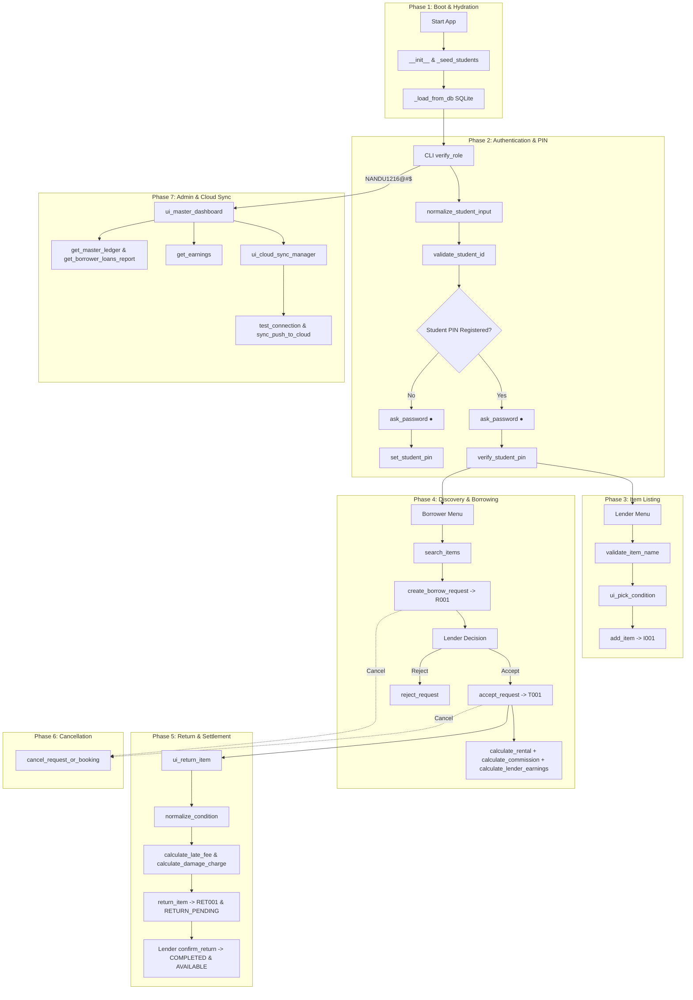

# LENTRA
### Student-to-Student Resource Lending & Borrowing Management System
# DESIGN DOCUMENT | Program Design & Development

---

## System Overview
**Lentra** is a Python terminal application that connects students who need an item temporarily with students willing to lend items they already own. It supports student verification, 4-digit security PIN protection, item listing, browsing, borrow requests, lender decisions, borrowing, returns, late fees, damage charges, cancellations, earnings, history, persistent relational SQLite storage, and remote cloud backup via Supabase.
- **Primary roles:** Lender and Borrower, plus an administrative Master Audit Dashboard.
- **Access control:** Required `AU25UG001`–`AU25UG100` Student ID cohort with support for shorthand roll numbers (`1`–`100`).
- **Academic simulation:** No real monetary payment is processed.
- **Terminal interface:** Clean numbered menus, ANSI color styling, real-time password dot masking (`●`), and robust validation error handling.

---

## Design Goals
- Keep item, request, and transaction states explicit so invalid status transitions are strictly prevented.
- Keep rental, commission, lender earnings, late-fee, and damage calculations deterministic and mathematically exact.
- Retain complete request, return, earnings, cancellation, and transaction audit trails across sessions using SQLite DBMS persistence (`borrow_app.db`).
- Enforce account safety through personal 4-digit security PINs with direct real-time dot masking (`ask_password`).
- Provide dual-write synchronization to a remote Supabase PostgreSQL cloud backend for cross-device persistence.

---

## 1. Terminology and Formulae

### 1.1 Data Model & Terminology
The application defines six core entities to model campus peer-to-peer resource sharing:

#### 1. Student
Represents a student using the application.
| Field | Type | Purpose |
| :--- | :--- | :--- |
| `student_id` | `str` | Student ID in the required `AU25UG001`–`AU25UG100` format. |
| `name` | `str` | Student full name (e.g., "Student 007"). |
| `pin` | `str` | 4-digit numeric security PIN for session authentication. |
| `items` | `list[Item]` | Items listed by the student as lender. |
| `requests` | `list[BorrowRequest]` | Requests created or received by the student. |
| `history` | `list[Transaction]` | Completed borrowing/lending transaction records. |

#### 2. Item
Represents an equipment or resource offered for peer lending.
| Field | Type | Purpose |
| :--- | :--- | :--- |
| `item_id` | `str` | Unique auto-generated sequential identifier (`I001`, `I002`, ...). |
| `name` | `str` | Descriptive name of the item (e.g., "Casio FX-991EX Calculator"). |
| `condition` | `str` | 5-star rating entered when listed (e.g., "★★★★☆ Very Good"). |
| `rental_price_per_day` | `float` | Positive daily rental price in Indian Rupees (₹). |
| `lender_id` | `str` | Student ID of the owner/lender (e.g., `AU25UG007`). |
| `status` | `str` | Current item state: `AVAILABLE`, `REQUESTED`, or `BORROWED`. |

#### 3. Borrow Request
Created when a borrower requests to rent an available item.
| Field | Type | Purpose |
| :--- | :--- | :--- |
| `request_id` | `str` | Unique sequential identifier (`R001`, `R002`, ...). |
| `item_id` | `str` | Identifier of the item being requested. |
| `borrower_id` | `str` | Student ID of the borrower making the request. |
| `lender_id` | `str` | Student ID of the lender who owns the item. |
| `duration_days` | `int` | Requested duration in positive whole calendar days. |
| `requested_on` | `date` | Calendar date on which the request was submitted. |
| `status` | `str` | State of request: `PENDING`, `ACCEPTED`, `REJECTED`, or `CANCELLED`. |

#### 4. Transaction
Created when a lender accepts a borrow request. Tracks the active loan lifecycle.
| Field | Type | Purpose |
| :--- | :--- | :--- |
| `transaction_id` | `str` | Unique loan transaction identifier (`T001`, `T002`, ...). |
| `request_id` | `str` | Reference to the original borrow request. |
| `item_id` | `str` | Identifier of the borrowed item. |
| `borrower_id` | `str` | Student ID of the borrower. |
| `lender_id` | `str` | Student ID of the lender. |
| `start_date` / `due_date` | `date` | Active borrowing start date and agreed return due date. |
| `duration_days` | `int` | Total loan duration in days. |
| `daily_rent` / `rental_amount` | `float` | Price per day and total base rental (`daily_rent × duration`). |
| `commission` / `lender_earnings`| `float` | 10% platform commission and 90% net lender earnings. |
| `status` | `str` | Loan state: `BORROWED`, `RETURN_PENDING`, `COMPLETED`, or `CANCELLED`. |
| `late_days` / `late_fee` | `int` / `float` | Overdue days and 20% daily late penalty. |
| `return_condition` / `damage_charge` | `str` / `float` | Condition at return and calculated damage penalty. |

#### 5. Return Record
Created when a borrower submits an item return awaiting lender confirmation.
| Field | Type | Purpose |
| :--- | :--- | :--- |
| `return_id` | `str` | Unique sequential identifier (`RET001`, `RET002`, ...). |
| `transaction_id` | `str` | Reference to the loan transaction. |
| `return_date` | `date` | Actual calendar date item was returned. |
| `return_condition` | `str` | Condition tier: `NO DAMAGE`, `MINOR`, `MODERATE`, `SEVERE`, `COMPLETE DAMAGE`. |
| `late_fee` / `damage_charge` | `float` | Calculated financial penalty values. |
| `status` | `str` | State: `RETURN_SUBMITTED` (pending inspection) or `CONFIRMED`. |

#### 6. Cancellation
Formal audit log generated whenever a request or booking is cancelled.
| Field | Type | Purpose |
| :--- | :--- | :--- |
| `cancellation_id` | `str` | Unique cancellation log identifier (`C001`, `C002`, ...). |
| `actor_id` | `str` | Student ID who initiated the cancellation. |
| `record_id` / `stage` | `str` | Target request/transaction ID and lifecycle stage. |
| `reason` / `cancelled_on` | `str` / `date` | Stated cancellation reason and calendar date. |

---

### 1.2 Entity State Values
| Entity | State Value | Meaning |
| :--- | :--- | :--- |
| **Item** | `AVAILABLE` | Item is in inventory and can be selected/requested by a borrower. |
| **Item** | `REQUESTED` | A borrower has requested the item; waiting for lender decision. |
| **Item** | `BORROWED` | Currently in an active borrowing period with a borrower. |
| **Request** | `PENDING` | Waiting for lender decision (`Accept` or `Reject`). |
| **Request** | `ACCEPTED` | Lender accepted the request; converted into an active `Transaction`. |
| **Request** | `REJECTED` | Lender rejected the request; request ends and item resets to `AVAILABLE`. |
| **Request** | `CANCELLED` | Eligible cancellation completed; item resets to `AVAILABLE`. |
| **Transaction**| `BORROWED` | Active loan currently ongoing. |
| **Transaction**| `RETURN_PENDING`| Borrower submitted return; awaiting physical lender inspection. |
| **Transaction**| `COMPLETED` | Lender confirmed return receipt; item reset to `AVAILABLE`. |
| **Transaction**| `CANCELLED` | Accepted booking cancelled before completion. |

---

### 1.3 Mathematical Formulae & Financial Rules
| Calculation | Formula / Business Rule | Example |
| :--- | :--- | :--- |
| **Rental Amount** | $\text{Daily Rental Price} \times \text{Borrowing Duration}$ | ₹50/day × 3 days = **₹150.00** |
| **Platform Commission** | $10\% \times \text{Rental Amount}$ (`COMMISSION_RATE = 0.10`) | ₹150.00 × 0.10 = **₹15.00** |
| **Lender Net Earnings** | $90\% \times \text{Rental Amount} = \text{Rental Amount} - \text{Commission}$ | ₹150.00 − ₹15.00 = **₹135.00** |
| **Late Days** | $\max(\text{Return Date} - \text{Due Date}, 0)$ | 2 days overdue $\rightarrow$ **2** |
| **Late Fee** | $20\% \times \text{Rental Amount} \times \text{Late Days}$ (`0.20/day`) | ₹150 × 0.20 × 2 = **₹60.00** |
| **No Damage** | 0% surcharge; no extra charge; no return breakdown displayed | **₹0.00** (Zero extra fee) |
| **Minor Damage** | $15\% \times \text{Rental Amount}$ (`DAMAGE_RATES['MINOR'] = 0.15`) | ₹150.00 × 0.15 = **₹22.50** |
| **Moderate Damage** | $55\% \times \text{Rental Amount}$ (`DAMAGE_RATES['MODERATE'] = 0.55`)| ₹150.00 × 0.55 = **₹82.50** |
| **Severe Damage** | $90\% \times \text{Rental Amount}$ (`DAMAGE_RATES['SEVERE'] = 0.90`)| ₹150.00 × 0.90 = **₹135.00** |
| **Complete Damage** | No automated percentage; full replacement cost settled directly with lender | Dynamic lender callout message |
| **Total Due on Return**| $\text{Rental Amount} + \text{Late Fee} + \text{Damage Charge}$ | ₹150 + ₹0 + ₹22.50 = **₹172.50** |

---

## 2. Program Flow

### 2.1 Overall Execution Flow
1. **Launch Application:** Launch terminal application (`python main.py`); load local SQLite database (`borrow_app.db`) and `.env` Supabase cloud credentials.
2. **Main Menu:** Display options: `1. Lender`, `2. Borrower`, `3. Admin` (or direct passkey shortcut `NANDU1216@#$`), `4. Exit`.
3. **Student Authentication:** Obtain and validate Student ID (`AU25UG001`–`AU25UG100`) or shorthand roll number (`1`–`100`).
   - *First-time login:* Prompt to register a personal 4-digit security PIN.
   - *Returning login:* Verify existing PIN with direct real-time dot masking (`●`) and 3-attempt lockout.
4. **Lender Operations:**
   - Add new items with interactive 5-star condition picker (`ui_pick_condition`).
   - View inventory with pending notification badging (`🔔 NOTIFICATIONS`).
   - Accept or Reject borrow requests.
   - Confirm returned items or use `0. ⚡ 1-Click Approve & Settle All`.
5. **Borrower Operations:**
   - Browse available items (excluding own items) and select duration.
   - Submit borrow request for lender review and approval.
   - Return items with live damage cost breakdown preview for damaged items (`ui_return_item`).
   - Cancel pending requests or accepted bookings.
6. **Admin Operations:**
   - Authenticate via passkey `NANDU1216@#$`.
   - Access Master Audit Dashboard with colored KPI banner, Section 1 (Lender Inventory), and Section 2 (Borrower Loans tracking `[NOT RETURNED]` vs `[RETURNED]`).
   - Trigger DBMS diagnostics or Push data to Supabase PostgreSQL cloud.

---

### 2.2 Navigation Hierarchies

#### Main Menu
```
1. Lender
2. Borrower
3. Admin (Passkey: NANDU1216@#$)
4. Exit
```

#### Lender Flow
```
Lender -> Verify Student ID & 4-Digit PIN
       -> [Optional 0. ⚡ 1-Click Approve & Settle All]
       -> 1. Add Item for Lending
             -> Enter Item Name (Validation)
             -> Select 5-Star Condition (Interactive Picker)
             -> Enter Daily Rental Price (₹)
       -> 2. View My Listed Items
             -> Manage Individual Item
             -> Accept / Reject Pending Requests
             -> Confirm Pending Returns
       -> 3. View Earnings & Commission (Completed transactions, 10% cut, 90% net)
       -> 4. View Borrowing / Lending History
       -> 5. Back to Main Menu
```

#### Borrower Flow
```
Borrower -> Verify Student ID & 4-Digit PIN
         -> 1. Browse Available Items & Request
               -> Select Item from Numbered List
               -> Enter Borrowing Duration (Days > 0)
               -> [Submit Request (Pending Lender Review)]
         -> 2. Return an Item
               -> Select Active Borrowing
               -> Select Return Condition (No Damage / Minor / Moderate / Severe / Complete)
               -> [If Damaged: View Live Return Cost Breakdown Preview]
               -> Submit Return Record
               -> [Optional Instant Settlement Auto-Confirm]
         -> 3. View Charges & Summary
         -> 4. Cancel Request / Booking
         -> 5. View Borrowing / Lending History
         -> 6. Back to Main Menu
```

#### Admin Dashboard Flow (Passkey: `NANDU1216@#$`)
```
Admin -> Enter Passkey NANDU1216@#$
      -> Master Audit Dashboard:
            -> KPI Metrics Banner (Active Users, Total Items, Borrowed, Pending, Completed)
            -> Section 1: Lender Asset Inventory Report
            -> Section 2: Borrower Loans Report ([NOT RETURNED] vs [RETURNED])
            -> Actions:
                  [1] Filter by Lender AU_ID
                  [2] Detailed Ledger Cards
                  [3] Student Directory
                  [4] DBMS Diagnostics
                  [5] Cloud Sync Manager (Push to Supabase)
                  [Enter] Back to Main Menu
```

---

## 3. File Organization and Data Structure

### 3.1 File Organization
The Lentra application is structured into modular Python files with clean separation of concerns:

```
Student req/
├── main.py              # Tier 1: Presentation Layer (CLI menus, ANSI styling, dot password masking)
├── logic.py             # Tier 2: Business Logic Layer (Data models, math formulas, workflows)
├── database.py          # Tier 3: Persistence Layer (SQLite relational DBMS manager, foreign keys)
├── supabase_sync.py     # Tier 4: Cloud Sync Layer (Supabase PostgreSQL dual-write sync)
├── borrow_app.db        # Relational SQLite database file on disk
├── .env                 # Environment credentials (SUPABASE_URL, SUPABASE_KEY)
├── .gitignore           # Git ignore policy protecting secrets and local DB files
├── test.py              # Core business logic unit test suite (16 tests)
├── test_db.py           # DBMS & cloud integration test suite
├── sql/
│   ├── schema.sql       # ANSI SQL DDL schema definitions with foreign keys
│   └── seed_data.sql    # Seed script for initial 100 students and items
└── docs/
    ├── DESIGN_DOCUMENT.md             # Markdown design specification
    ├── LENTRA_DESIGN_DOCUMENT.docx    # Word Design Document
    ├── FUNCTIONAL_REQUIREMENTS.md     # Product requirement document v2.1
    └── CODE_EXPLANATION_FOR_TEACHER.md# Presentation & viva preparation guide
```

| File Name | Architecture Role | Purpose |
| :--- | :--- | :--- |
| `main.py` | Presentation (UI) | Handles main menu, ANSI colors, password dot masking, condition star picker, return cost breakdown, and admin dashboard. |
| `logic.py` | Domain Logic | Contains core dataclasses, formulas, validation rules, state transitions, and audit aggregations. |
| `database.py` | Data Access (SQLite) | Manages SQLite connection, table schema creation, parameterized SQL queries, and foreign key integrity. |
| `supabase_sync.py`| Cloud Integration | Provides asynchronous background thread dual-write synchronization to remote Supabase PostgreSQL. |
| `borrow_app.db` | Persistent Storage | ACID-compliant SQLite database storing all tables across terminal restarts. |
| `test.py` | Unit Test Suite | 16 automated tests covering IDs, items, rental math, duration, returns, damage rules, and cancellations. |
| `test_db.py` | Integration Test Suite | Automated tests for SQLite persistence, foreign keys, PIN persistence, admin passkey, and Supabase sync. |

---

### 3.2 Data Structures Used in Lentra
| Data Structure | Implementation in Python | Usage in Lentra |
| :--- | :--- | :--- |
| **Dictionary (`Dict`)** | `self.students: Dict[str, Student]`<br>`self.items: Dict[str, Item]`<br>`self.requests: Dict[str, BorrowRequest]`<br>`self.transactions: Dict[str, Transaction]` | $\mathcal{O}(1)$ constant-time record lookup, retrieval, key uniqueness guarantee, and in-place state mutation. |
| **List (`List`)** | `self.history: List[dict]`<br>`search_items() -> List[Item]` | Preserving chronological order for audit logs, ordered menu rendering, catalog search filtering, and reporting. |
| **Data Class (`@dataclass`)** | `Student`, `Item`, `BorrowRequest`, `Transaction`, `ReturnRecord`, `Cancellation` | Object-oriented entity templates with automatic constructors (`__init__`) and strong typing. |
| **Set (`set`)** | `active = set(...)` | Calculating distinct active students across transactions, inventory, and registered PINs. |
| **String (`str`)** | `student_id`, `pin`, `item_id`, `status` | Alphanumeric IDs, masked passwords, text descriptions, and state enums. |
| **Integer (`int`)** | `duration_days`, `late_days` | Whole-number day counts, counters, and array indexing. |
| **Float (`float`)** | `rental_price_per_day`, `commission` | Monetary figures rounded to 2 decimal places using `round_money()`. |
| **Date (`date`)** | `start_date`, `due_date`, `return_date` | Calendar dates and duration arithmetic via Python's `datetime.timedelta`. |
| **Relational Tables** | SQLite 3 Tables with `FOREIGN KEY`s | Permanent disk storage surviving application restarts with full ACID integrity. |

---

## 4. Function Signatures

| Function Signature | Module | What it is for |
| :--- | :---: | :--- |
| `validate_student_id(student_id: str) -> Tuple[bool, str]` | `logic.py` | Validates ID against pattern `AU25UG(001–100)`; returns normalized uppercase ID or error. |
| `normalize_student_input(input_val: str) -> Tuple[bool, str]` | `logic.py` | Normalizes shorthand roll numbers (`7`) or full IDs (`AU25UG007`) into standard format. |
| `set_student_pin(student_id: str, pin: str) -> Tuple[bool, str]` | `logic.py` | Validates 4-digit PIN, checks uniqueness across cohort, saves to memory and database. |
| `verify_student_pin(student_id: str, pin: str) -> bool` | `logic.py` | Verifies entered PIN against stored student credentials. |
| `calculate_rental(daily_price: float, days: int) -> float` | `logic.py` | Calculates base rental amount: $\text{daily\_price} \times \text{days}$. |
| `calculate_commission(rental_amount: float) -> float` | `logic.py` | Calculates 10% platform commission fee from rental amount. |
| `calculate_lender_earnings(rental_amount: float) -> float` | `logic.py` | Calculates net 90% lender earnings ($\text{rental} - \text{commission}$). |
| `calculate_late_fee(rental_amount: float, days: int) -> float` | `logic.py` | Calculates 20% of original rental fee per overdue day. |
| `calculate_damage_charge(rental: float, cond: str) -> Optional[float]` | `logic.py` | Applies damage rate (15% Minor, 55% Moderate, 90% Severe; None for Complete). |
| `normalize_condition(condition: str) -> str` | `logic.py` | Standardizes user condition inputs to official damage tier keywords. |
| `add_item(lender_id: str, name: str, cond: str, price: float) -> Tuple[bool, str]` | `logic.py` | Validates item data, generates sequential `I001` ID, and persists item to memory and SQLite. |
| `search_items(required_item: str = "") -> List[Item]` | `logic.py` | Returns all `AVAILABLE` items matching an optional search keyword sorted by ID. |
| `create_borrow_request(borrower_id: str, item_id: str, days: int) -> Tuple[bool, str]` | `logic.py` | Validates availability, creates `R001` request, and updates item status to `REQUESTED`. |
| `accept_request(lender_id: str, req_id: str, start_date: Optional[date]) -> Tuple[bool, str]` | `logic.py` | Creates `T001` Transaction with due dates & financials; updates item status to `BORROWED`. |
| `reject_request(lender_id: str, req_id: str) -> Tuple[bool, str]` | `logic.py` | Rejects pending request; resets item status back to `AVAILABLE`. |
| `return_item(borrower_id: str, tx_id: str, cond: str, ret_date: Optional[date]) -> Tuple[bool, str]` | `logic.py` | Computes late fees and damage; creates `RET001` record; sets `RETURN_PENDING`. |
| `confirm_return(lender_id: str, ret_id: str) -> Tuple[bool, str]` | `logic.py` | Lender confirms return; completes transaction; resets item status to `AVAILABLE`. |
| `cancel_request_or_booking(student_id: str, rec_id: str, reason: str) -> Tuple[bool, str]` | `logic.py` | Cancels pending request or active booking; resets item status to `AVAILABLE`. |
| `get_earnings(lender_id: str) -> dict` | `logic.py` | Aggregates completed loans, 10% commission, and 90% net earnings for a lender. |
| `get_master_ledger() -> List[dict]` | `logic.py` | Generates comprehensive audit matrix of all items, loans, and `[NOT RETURNED]` statuses. |
| `get_borrower_loans_report(lender_filter: Optional[str]) -> List[dict]` | `logic.py` | Relational multi-table report showing who borrowed what from a lender and for how long. |
| `ask_password(prompt: str, mask_char: str) -> str` | `main.py` | Reads keystrokes via `msvcrt`; displays real-time `●` dots without echoing characters. |
| `validate_item_name(raw_name: str) -> Tuple[bool, str]` | `main.py` | Validates item name; rejects empty strings, purely numbers, symbols, and keyboard mash. |
| `ui_pick_condition() -> str | None` | `main.py` | Interactive 5-star condition picker; illuminates gold stars in real-time via arrow keys. |
| `ui_master_dashboard(lender_filter: str | None) -> None` | `main.py` | Renders administrative oversight dashboard with KPI banner and relational sections. |
| `ui_cloud_sync_manager() -> None` | `main.py` | Interactive cloud menu to test connection and push local tables to Supabase. |
| `test_connection() -> Tuple[bool, str]` | `supabase_sync.py` | Executes heartbeat query against remote Supabase PostgreSQL to verify connectivity. |

---

## 5. Function-Level Algorithms

### 5.1 End-to-End System Algorithm Flow Using Mentioned Functions

The complete operational flow of Lentra coordinates all 27 functions across seven sequential lifecycle phases. The following walkthrough explains the end-to-end execution flow, detailing exactly which functions are invoked, their input/output contracts, and their state transitions:



#### Detailed Lifecycle Phases:

1. **Phase 1: Boot & State Hydration (`logic.py`, `database.py`)**
   - When `main.py` launches, `BorrowInsteadOfBuyApp.__init__` instantiates in-memory dictionaries: `students`, `items`, `requests`, `transactions`, `returns`, and `history`.
   - `_seed_students()` populates the required cohort (`AU25UG001` through `AU25UG100`).
   - If `borrow_app.db` exists, `_load_from_db()` executes SQL `SELECT` queries across all relational tables, restoring active items, requests, PIN credentials, transactions, and return records into RAM.

2. **Phase 2: Authentication & Identity Verification (`main.py`, `logic.py`)**
   - The user selects `1. Lender` or `2. Borrower` in `BorrowInsteadOfBuyCLI.verify_role()`.
   - The user enters their roll number (e.g., `7`) or full Student ID (e.g., `AU25UG007`).
   - `normalize_student_input(input_val)` parses the numeric input into canonical `AU25UG007` and forwards it to `validate_student_id(student_id)`.
   - `validate_student_id(student_id)` validates against regex `^AU25UG(\d{3})$` and ensures the integer is strictly between 1 and 100.
   - **First-Time Student:** If `student.pin` is empty, `ask_password("Create 4-Digit PIN: ")` captures 4 numeric keystrokes with real-time `●` dot masking. Then `set_student_pin(student_id, pin)` checks cohort-wide uniqueness and commits the PIN to SQLite table `students`.
   - **Returning Student:** `ask_password("Enter 4-Digit PIN: ")` captures keystrokes, and `verify_student_pin(student_id, pin)` verifies the entry against stored credentials with a 3-attempt security lockout.

3. **Phase 3: Item Listing & Condition Verification (`main.py`, `logic.py`)**
   - The lender selects `1. Add Item for Lending`.
   - The user enters an item name; `validate_item_name(raw_name)` validates that the name is at least 3 characters long, contains at least 2 alphabetic letters, is not purely numeric, and is not random keyboard mash (e.g., `'asdf'`, `'1234'`).
   - `ui_pick_condition()` launches an interactive 5-star selector where arrow keys dynamically illuminate gold stars (`★`) and empty gray stars (`☆`).
   - The lender enters the daily rental price in ₹.
   - `add_item(lender_id, name, condition, rental_price_per_day)` validates positive price, generates sequential ID `'I001'`, creates the `Item` dataclass with `status='AVAILABLE'`, and persists it to SQLite table `items`.

4. **Phase 4: Item Discovery, Requesting & Borrowing (`main.py`, `logic.py`)**
   - The borrower selects `1. Browse Available Items & Request`.
   - `search_items(required_item)` filters inventory for `status == 'AVAILABLE'` items (excluding the borrower's own items) matching an optional keyword.
   - The borrower selects an item number and specifies the duration in whole calendar days ($> 0$).
   - `create_borrow_request(borrower_id, item_id, duration_days)` checks that the item is currently `AVAILABLE`, prevents self-borrowing, creates request `'R001'` with `status='PENDING'`, updates item `status='REQUESTED'`, and commits to SQLite table `borrow_requests`.
   - **Approval Step:** The lender reviews pending requests and calls `accept_request(lender_id, req_id)`.
     - `calculate_rental(daily_price, days)` computes total base rent.
     - `calculate_commission(rental_amount)` deducts 10% platform commission.
     - `calculate_lender_earnings(rental_amount)` allocates 90% net earnings.
     - A new `Transaction` (`'T001'`) is generated with `start_date`, `due_date`, and `status='BORROWED'`.
     - The item status updates to `'BORROWED'`.
   - *(Note: All requests require explicit lender review and approval before activating into a transaction).*
   - Alternatively, if the lender rejects the request, `reject_request(lender_id, req_id)` marks the request as `'REJECTED'` and resets the item status back to `'AVAILABLE'`.

5. **Phase 5: Item Return, Damage Assessment & Settlement (`main.py`, `logic.py`)**
   - The borrower selects `2. Return an Item`. Active `BORROWED` transactions are displayed.
   - The borrower selects the return condition tier (`NO DAMAGE`, `MINOR`, `MODERATE`, `SEVERE`, or `COMPLETE DAMAGE`).
   - `return_item(borrower_id, tx_id, condition, return_date)` coordinates the return calculations:
     - `normalize_condition(condition)` standardizes the input string.
     - `calculate_late_fee(rental_amount, late_days)` applies a 20% penalty per overdue day beyond `due_date`.
     - `calculate_damage_charge(rental_amount, normalized_condition)` looks up the damage tier rate (15% Minor, 55% Moderate, 90% Severe; None for Complete).
     - Transaction updates to `status='RETURN_PENDING'`. A `ReturnRecord` (`'RET001'`) is stored with `status='RETURN_SUBMITTED'`.
   - **UI Presentation Rule:** In `main.py`, if damage is detected, a colorful **RETURN COST BREAKDOWN** box is displayed (`Base Rent + Damage Fee = Total to Pay`). If `NO DAMAGE`, zero extra return fee is displayed.
   - **Confirmation Step:** The lender physically inspects the item and calls `confirm_return(lender_id, ret_id)`. The return record status transitions to `'CONFIRMED'`, the transaction transitions to `'COMPLETED'`, financial totals are locked, and the item status automatically resets to `'AVAILABLE'` so other students can borrow it.

6. **Phase 6: Booking & Request Cancellation (`logic.py`)**
   - A student calls `cancel_request_or_booking(student_id, record_id, reason)`.
   - If `record_id` is a `PENDING` request: request status becomes `'CANCELLED'`, item status resets to `'AVAILABLE'`, and a cancellation log is generated with `stage='PENDING_REQUEST'`.
   - If `record_id` is an active `BORROWED` booking: transaction and request status become `'CANCELLED'`, item status resets to `'AVAILABLE'`, and a cancellation log is generated with `stage='ACCEPTED_BOOKING'`.

7. **Phase 7: Administration, Diagnostics & Cloud Sync (`main.py`, `logic.py`, `supabase_sync.py`)**
   - Administrative login is accessed by entering `3` at the main menu or entering the secret passkey `NANDU1216@#$` directly.
   - `ui_master_dashboard()` runs:
     - `get_master_ledger()` to compile all items, active loans, and overdue badges (`[NOT RETURNED]` vs `[RETURNED]`).
     - `get_borrower_loans_report(lender_filter)` to produce the relational borrower-lender-item loan report.
     - `get_earnings(lender_id)` to audit 10% platform cuts and 90% lender disbursements.
   - The admin selects `[5] Cloud Sync Manager`, which launches `ui_cloud_sync_manager()`.
   - `test_connection()` pings remote Supabase PostgreSQL with a heartbeat select query to verify cloud health.
   - The admin triggers bulk synchronization, upserting all local SQLite records into the cloud database.

---

### 5.2 Step-by-Step Algorithms for Each Function

#### 1. `validate_student_id(student_id: str) -> Tuple[bool, str]`
- **Module:** `logic.py`
- **Inputs:** `student_id: str`
- **Outputs:** `Tuple[bool, str]` (Success flag and normalized ID or validation error)
- **Algorithm:**
  1. Check if `student_id` is `None` or whitespace; if so, return `(False, "Student ID is required.")`.
  2. Strip whitespace and convert to uppercase: `normalized = student_id.strip().upper()`.
  3. Evaluate against regular expression: `re.fullmatch(r"AU25UG(\d{3})", normalized)`.
  4. If regex fails to match, return `(False, "Invalid Student ID. Use AU25UG001 to AU25UG100.")`.
  5. Parse capture group 1 as an integer: `num = int(match.group(1))`.
  6. Check integer bounds: if `num < 1` or `num > 100`, return `(False, "The last three digits must be 001 to 100.")`.
  7. Return `(True, normalized)`.

#### 2. `normalize_student_input(input_val: str) -> Tuple[bool, str]`
- **Module:** `logic.py`
- **Inputs:** `input_val: str` (Console user input)
- **Outputs:** `Tuple[bool, str]` (Success flag and canonical ID or error)
- **Algorithm:**
  1. Strip whitespace: `val = input_val.strip()`. If empty, return `(False, "Student ID or Roll No is required.")`.
  2. If `val.isdigit()` is `True`:
     a. Parse integer: `num = int(val)`.
     b. Verify `1 <= num <= 100`. If false, return `(False, "Roll number must be between 1 and 100.")`.
     c. Format as zero-padded ID: `candidate = f"AU25UG{num:03d}"`.
     d. Forward `candidate` to `verify_student_id(candidate)` and return the result.
  3. If not purely numeric, pass `val.upper()` to `verify_student_id(val.upper())`.
  4. Return the tuple returned by `verify_student_id`.

#### 3. `set_student_pin(student_id: str, pin: str) -> Tuple[bool, str]`
- **Module:** `logic.py`
- **Inputs:** `student_id: str`, `pin: str`
- **Outputs:** `Tuple[bool, str]` (Success flag and confirmation/error message)
- **Algorithm:**
  1. Validate `student_id` via `verify_student_id(student_id)`. If invalid, return `(False, error)`.
  2. Clean PIN string: `clean_pin = pin.strip()`.
  3. Validate length and numeric characters: if `len(clean_pin) != 4` or `not clean_pin.isdigit()`, return `(False, "PIN must be exactly 4 numeric digits (e.g. 1234).")`.
  4. Check uniqueness across cohort: call `is_pin_taken(clean_pin, exclude_student_id=student_id)`.
  5. If already assigned to another student, return `(False, "The PIN is already used. Please choose a different PIN.")`.
  6. Update student entity in memory: `self.students[student_id].pin = clean_pin`.
  7. If persistent SQLite database is connected, execute `self.db.save_student(student_id, student.name, clean_pin)`.
  8. Return `(True, "PIN set successfully.")`.

#### 4. `verify_student_pin(student_id: str, pin: str) -> bool`
- **Module:** `logic.py`
- **Inputs:** `student_id: str`, `pin: str`
- **Outputs:** `bool` (`True` if valid match, `False` otherwise)
- **Algorithm:**
  1. Retrieve student object: `student = self.students.get(student_id)`.
  2. If `student` is `None` or `student.pin` is `None`, return `False`.
  3. Compare `student.pin == pin.strip()`.
  4. Return boolean comparison result.

#### 5. `calculate_rental(daily_price: float, days: int) -> float`
- **Module:** `logic.py`
- **Inputs:** `daily_price: float`, `days: int`
- **Outputs:** `float` (Total rental rounded to 2 decimal places)
- **Algorithm:**
  1. Compute raw product: `raw = float(daily_price) * int(days)`.
  2. Apply financial rounding function: `round_money(raw)` where `round_money(v) = round(float(v) + 1e-10, 2)`.
  3. Return calculated value.

#### 6. `calculate_commission(rental_amount: float) -> float`
- **Module:** `logic.py`
- **Inputs:** `rental_amount: float`
- **Outputs:** `float` (10% platform commission)
- **Algorithm:**
  1. Multiply `rental_amount` by constant `COMMISSION_RATE` (`0.10`).
  2. Apply `round_money(rental_amount * 0.10)`.
  3. Return rounded fee.

#### 7. `calculate_lender_earnings(rental_amount: float) -> float`
- **Module:** `logic.py`
- **Inputs:** `rental_amount: float`
- **Outputs:** `float` (Net 90% lender earnings)
- **Algorithm:**
  1. Calculate commission: `comm = calculate_commission(rental_amount)`.
  2. Calculate net difference: `net = rental_amount - comm`.
  3. Return `round_money(net)`.

#### 8. `calculate_late_fee(rental_amount: float, days: int) -> float`
- **Module:** `logic.py`
- **Inputs:** `rental_amount: float`, `days: int` (Overdue calendar days)
- **Outputs:** `float` (Late penalty amount)
- **Algorithm:**
  1. Guard against non-positive days: `overdue = max(int(days), 0)`.
  2. If `overdue == 0`, return `0.0`.
  3. Calculate fee: `fee = rental_amount * LATE_FEE_RATE_PER_DAY (0.20) * overdue`.
  4. Return `round_money(fee)`.

#### 9. `calculate_damage_charge(rental: float, cond: str) -> Optional[float]`
- **Module:** `logic.py`
- **Inputs:** `rental: float`, `cond: str` (Condition tier string)
- **Outputs:** `Optional[float]` (Damage charge in ₹, or `None` if Complete Damage)
- **Algorithm:**
  1. Standardize condition string: `key = normalize_condition(cond)`.
  2. Look up percentage in `DAMAGE_RATES` dictionary:
     - `'NO DAMAGE'`: `0.0`
     - `'MINOR'`: `0.15`
     - `'MODERATE'`: `0.55`
     - `'SEVERE'`: `0.90`
     - `'COMPLETE DAMAGE'`: `None`
  3. If rate is `None`, return `None` (indicates direct lender replacement settlement).
  4. If rate is `0.0`, return `0.0`.
  5. Return `round_money(rental * rate)`.

#### 10. `normalize_condition(condition: str) -> str`
- **Module:** `logic.py`
- **Inputs:** `condition: str`
- **Outputs:** `str` (Canonical uppercase condition tier)
- **Algorithm:**
  1. Strip whitespace and convert to uppercase: `raw = condition.strip().upper()`.
  2. Search aliases dictionary:
     - `'GOOD'`, `'NO DAMAGE'`, `'CLEAN'`, `'EXCELLENT'` $\rightarrow$ `'NO DAMAGE'`
     - `'MINOR'`, `'MINOR DAMAGE'`, `'SLIGHT SCRATCH'` $\rightarrow$ `'MINOR'`
     - `'MODERATE'`, `'MODERATE DAMAGE'` $\rightarrow$ `'MODERATE'`
     - `'SEVERE'`, `'MAJOR'`, `'MAJOR DAMAGE'`, `'SEVERE DAMAGE'` $\rightarrow$ `'SEVERE'`
     - `'COMPLETE'`, `'COMPLETE DAMAGE'`, `'BROKEN'` $\rightarrow$ `'COMPLETE DAMAGE'`
  3. Return mapped canonical keyword, or `raw` if already canonical.

#### 11. `add_item(lender_id: str, name: str, cond: str, price: float) -> Tuple[bool, str]`
- **Module:** `logic.py`
- **Inputs:** `lender_id: str`, `name: str`, `cond: str`, `price: float`
- **Outputs:** `Tuple[bool, str]` (Success flag and generated `item_id` or error)
- **Algorithm:**
  1. Validate `lender_id` via `verify_student_id(lender_id)`. If invalid, return `(False, error)`.
  2. Validate name: if empty, return `(False, "Item name is required.")`. If `name.strip().isdigit()`, return `(False, "Item name cannot be purely numbers.")`.
  3. Validate condition: if empty, return `(False, "Item condition is required.")`.
  4. Validate price: if `price <= 0`, return `(False, "Daily rental price must be positive.")`.
  5. Generate sequential ID: find lowest unused integer $k \ge 1$ such that `f"I{k:03d}"` not in `self.items`.
  6. Instantiate `Item(item_id, name.strip(), cond.strip(), round_money(price), lender_id, status="AVAILABLE")`.
  7. Store in dictionary: `self.items[item_id] = item`.
  8. If SQLite database is connected, call `self.db.save_item(item)`.
  9. If cloud sync active, queue background write `sync_item(item)`.
  10. Return `(True, item_id)`.

#### 12. `search_items(required_item: str = "") -> List[Item]`
- **Module:** `logic.py`
- **Inputs:** `required_item: str` (Optional search keyword, default empty)
- **Outputs:** `List[Item]` (Matching available items sorted by ID)
- **Algorithm:**
  1. Convert search keyword to lowercase: `term = required_item.strip().lower()`.
  2. Filter `self.items.values()`:
     - Keep item if `item.status == "AVAILABLE"` AND (`term == ""` OR `term in item.name.lower()` OR `term in item.condition.lower()`).
  3. Sort resulting list ascending by `item.item_id`.
  4. Return sorted list.

#### 13. `create_borrow_request(borrower_id: str, item_id: str, days: int) -> Tuple[bool, str]`
- **Module:** `logic.py`
- **Inputs:** `borrower_id: str`, `item_id: str`, `days: int`
- **Outputs:** `Tuple[bool, str]` (Success flag and generated `request_id` or error)
- **Algorithm:**
  1. Validate `borrower_id` via `verify_student_id`. If invalid, return `(False, error)`.
  2. Check `item_id` exists in `self.items`. If not, return `(False, "Item not found.")`.
  3. Check duration: if `not isinstance(days, int)` or `days <= 0`, return `(False, "Borrowing duration must be a positive whole number.")`.
  4. Retrieve item: if `item.lender_id == borrower_id`, return `(False, "You cannot borrow your own item.")`.
  5. Check status: if `item.status != "AVAILABLE"`, return `(False, "Item is not available.")`.
  6. Check existing pending requests: if any request for this item in `self.requests` has `status == "PENDING"`, return `(False, "A pending request already exists for this item.")`.
  7. Generate next sequential Request ID (`"R001"`).
  8. Instantiate `BorrowRequest(req_id, item_id, borrower_id, item.lender_id, days, self.today, status="PENDING")`.
  9. Store in `self.requests[req_id] = request`.
  10. Update item status: `item.status = "REQUESTED"`.
  11. If SQLite connected, call `self.db.save_request(request)` and `self.db.update_item_status(item_id, "REQUESTED")`.
  12. Return `(True, req_id)`.

#### 14. `accept_request(lender_id: str, req_id: str, start_date: Optional[date] = None) -> Tuple[bool, str]`
- **Module:** `logic.py`
- **Inputs:** `lender_id: str`, `req_id: str`, optional `start_date: date`
- **Outputs:** `Tuple[bool, str]` (Success flag and generated `transaction_id` or error)
- **Algorithm:**
  1. Validate `lender_id`.
  2. Retrieve request: verify `request` exists, `request.lender_id == lender_id`, and `request.status == "PENDING"`.
  3. Retrieve item: verify `item.status == "REQUESTED"`.
  4. Compute financial breakdown:
     - `rent = calculate_rental(item.rental_price_per_day, request.duration_days)`
     - `comm = calculate_commission(rent)`
     - `earn = calculate_lender_earnings(rent)`
  5. Compute calendar dates:
     - `start = start_date or self.today`
     - `due = start + timedelta(days=request.duration_days)`
  6. Update request: `request.status = "ACCEPTED"`.
  7. Generate next sequential Transaction ID (`"T001"`).
  8. Instantiate `Transaction(tx_id, req_id, item.item_id, request.borrower_id, lender_id, start, due, request.duration_days, item.rental_price_per_day, rent, comm, earn, status="BORROWED")`.
  9. Store in `self.transactions[tx_id] = tx`.
  10. Update item status: `item.status = "BORROWED"`.
  11. Append `BORROWING_STARTED` event to `self.history`.
  12. If SQLite connected, commit request update, transaction insert, item status update, and history insert.
  13. Return `(True, tx_id)`.

#### 15. `reject_request(lender_id: str, req_id: str) -> Tuple[bool, str]`
- **Module:** `logic.py`
- **Inputs:** `lender_id: str`, `req_id: str`
- **Outputs:** `Tuple[bool, str]` (Success flag and message)
- **Algorithm:**
  1. Validate `lender_id`.
  2. Retrieve request: verify `request.lender_id == lender_id` and `request.status == "PENDING"`.
  3. Update request status: `request.status = "REJECTED"`.
  4. Retrieve item: reset `item.status = "AVAILABLE"`.
  5. If SQLite connected, commit request update and item status update.
  6. Return `(True, "Borrow request rejected. Item is available again.")`.

#### 16. `return_item(borrower_id: str, tx_id: str, cond: str, ret_date: Optional[date] = None) -> Tuple[bool, str]`
- **Module:** `logic.py`
- **Inputs:** `borrower_id: str`, `tx_id: str`, `cond: str`, optional `ret_date: date`
- **Outputs:** `Tuple[bool, str]` (Success flag and generated `return_id` or message)
- **Algorithm:**
  1. Validate `borrower_id`.
  2. Retrieve transaction: verify `tx.borrower_id == borrower_id` and `tx.status == "BORROWED"`.
  3. Standardize condition: `norm_cond = normalize_condition(cond)`.
  4. Determine return date: `actual_return = ret_date or self.today`.
  5. Calculate overdue days: `late_days = max((actual_return - tx.due_date).days, 0)`.
  6. Calculate late fee: `late_fee = calculate_late_fee(tx.rental_amount, late_days)`.
  7. Calculate damage charge: `dmg_charge = calculate_damage_charge(tx.rental_amount, norm_cond) or 0.0`.
  8. Update transaction fields: `returned_on = actual_return`, `late_days = late_days`, `late_fee = late_fee`, `return_condition = norm_cond`, `damage_charge = dmg_charge`, `status = "RETURN_PENDING"`.
  9. Generate next sequential Return ID (`"RET001"`).
  10. Instantiate `ReturnRecord(ret_id, tx_id, tx.item_id, borrower_id, tx.lender_id, actual_return, norm_cond, late_fee, dmg_charge, status="RETURN_SUBMITTED")`.
  11. Store in `self.returns[ret_id] = record`.
  12. If SQLite connected, commit updated transaction and new return record.
  13. If `norm_cond == "COMPLETE DAMAGE"`, return `(True, "Consult lender for replacement settlement.")`.
  14. Otherwise, return `(True, ret_id)`.

#### 17. `confirm_return(lender_id: str, ret_id: str) -> Tuple[bool, str]`
- **Module:** `logic.py`
- **Inputs:** `lender_id: str`, `ret_id: str`
- **Outputs:** `Tuple[bool, str]` (Success flag and message)
- **Algorithm:**
  1. Validate `lender_id`.
  2. Retrieve return record: verify `record.lender_id == lender_id` and `record.status == "RETURN_SUBMITTED"`.
  3. Retrieve transaction `tx = self.transactions[record.transaction_id]` and item `item = self.items[record.item_id]`.
  4. Update return record: `record.status = "CONFIRMED"`.
  5. Update transaction: `tx.status = "COMPLETED"`.
  6. Reset item: `item.status = "AVAILABLE"` (item returns to available pool).
  7. Log `ITEM_RETURNED` event in `self.history`.
  8. If SQLite connected, commit return record update, transaction update, item update, and history insert.
  9. Return `(True, "Return confirmed. Transaction completed and item is available again.")`.

#### 18. `cancel_request_or_booking(student_id: str, rec_id: str, reason: str = "") -> Tuple[bool, str]`
- **Module:** `logic.py`
- **Inputs:** `student_id: str`, `rec_id: str`, optional `reason: str`
- **Outputs:** `Tuple[bool, str]` (Success flag and confirmation message)
- **Algorithm:**
  1. Validate `student_id`.
  2. **Check Pending Requests:** If `rec_id` is in `self.requests` with `borrower_id == student_id` and `status == "PENDING"`:
     a. Set `request.status = "CANCELLED"`.
     b. Reset corresponding item: `self.items[request.item_id].status = "AVAILABLE"`.
     c. Create `Cancellation` record with `stage="PENDING_REQUEST"`.
     d. Commit changes to SQLite.
     e. Return `(True, "Borrow request cancelled. Item is available again.")`.
  3. **Check Active Bookings:** If `rec_id` is in `self.transactions` with `borrower_id == student_id` and `status == "BORROWED"`:
     a. Set `tx.status = "CANCELLED"`.
     b. Reset corresponding item: `self.items[tx.item_id].status = "AVAILABLE"`.
     c. Mark original request as `"CANCELLED"`.
     d. Create `Cancellation` record with `stage="ACCEPTED_BOOKING"`.
     e. Commit changes to SQLite.
     f. Return `(True, "Accepted booking cancelled. Item is available again.")`.
  4. If neither matches, return `(False, "Request or booking not found for this student.")`.

#### 19. `get_earnings(lender_id: str) -> dict`
- **Module:** `logic.py`
- **Inputs:** `lender_id: str`
- **Outputs:** `dict` containing `completed_transactions`, `rental_amount`, `commission`, and `lender_earnings`
- **Algorithm:**
  1. Validate `lender_id`. If invalid, return zeroed summary dictionary.
  2. Filter `self.transactions.values()`: select transactions where `tx.lender_id == lender_id` and `tx.status == "COMPLETED"`.
  3. Sum totals:
     - `total_rent = sum(tx.rental_amount for tx in completed)`
     - `total_comm = sum(tx.commission for tx in completed)`
     - `total_net = sum(tx.lender_earnings for tx in completed)`
  4. Round values with `round_money`.
  5. Return `{"completed_transactions": len(completed), "rental_amount": total_rent, "commission": total_comm, "lender_earnings": total_net}`.

#### 20. `get_master_ledger() -> List[dict]`
- **Module:** `logic.py`
- **Inputs:** None (Invoked by admin dashboard)
- **Outputs:** `List[dict]` (Complete audit record for every item in inventory)
- **Algorithm:**
  1. Initialize `ledger = []`.
  2. Iterate through `sorted(self.items.values(), key=lambda x: x.item_id)`:
     a. Retrieve owner student name from `self.students`.
     b. Query transactions matching `item.item_id`.
     c. **Case 1: Active Loan (`status == "BORROWED"`):**
        - Fetch borrower name.
        - Check if overdue: `is_late = self.today > tx.due_date`.
        - Calculate `late_days = (self.today - tx.due_date).days if is_late else 0`.
        - Set `return_status = "NOT RETURNED"` with due date and overdue badge.
     d. **Case 2: Pending Request (`status == "REQUESTED"`):**
        - Set `return_status = "PENDING REQUEST"`.
     e. **Case 3: Past Completed Loan:**
        - Set `return_status = "RETURNED"` with return date and condition.
     f. **Case 4: Never Borrowed:**
        - Set `return_status = "AVAILABLE"`.
     g. Append structured dictionary to `ledger`.
  3. Return `ledger`.

#### 21. `get_borrower_loans_report(lender_filter: Optional[str] = None) -> List[dict]`
- **Module:** `logic.py`
- **Inputs:** Optional `lender_filter: str`
- **Outputs:** `List[dict]` (Relational multi-table report joining borrowers, lenders, and items)
- **Algorithm:**
  1. If SQLite database is connected, delegate to `self.db.get_borrower_loans_report(lender_filter)` to execute an optimized SQL `JOIN` across `transactions`, `items`, and `students`.
  2. Otherwise (in-memory mode), iterate through `self.transactions.values()`:
     a. Filter by `lender_filter` if specified.
     b. Join with borrower name, lender name, item name, and return records.
     c. Map status to `[NOT RETURNED]`, `[RETURN PENDING]`, `[RETURNED]`, or `[CANCELLED]`.
  3. Sort records by `lender_id`, then `transaction_id`.
  4. Return compiled list of dictionaries.

#### 22. `ask_password(prompt: str = "Enter Password: ", mask_char: str = "●") -> str`
- **Module:** `main.py`
- **Inputs:** `prompt: str`, `mask_char: str` (Default `"●"`)
- **Outputs:** `str` (Secret string entered by user)
- **Algorithm:**
  1. Print `prompt` without trailing newline and flush `sys.stdout`.
  2. Check if terminal is interactive (`sys.stdin.isatty()` and `os.name == 'nt'`). If not, fall back to `getpass.getpass`.
  3. Initialize character buffer: `chars = []`.
  4. Enter character capture loop using `msvcrt`:
     a. Read raw byte: `ch = msvcrt.getch()`.
     b. If `ch` in `(b'\r', b'\n')` (Enter): print newline and break out of loop.
     c. If `ch == b'\x08'` (Backspace):
        - If `chars` is non-empty, remove last character `chars.pop()`.
        - Write `"\b \b"` to console to erase dot, and flush stdout.
     d. If `ch == b'\x03'` (Ctrl+C): print newline and raise `KeyboardInterrupt`.
     e. If `ch` in `(b'\x00', b'\xe0')` (Special key prefix): consume and discard next byte `msvcrt.getch()`.
     f. Otherwise, decode byte as UTF-8 string:
        - If character is printable, append to `chars`.
        - Print `mask_char` (`"●"`) to console and flush stdout.
  5. Return concatenated string `''.join(chars).strip()`.

#### 23. `validate_item_name(raw_name: str) -> Tuple[bool, str]`
- **Module:** `main.py`
- **Inputs:** `raw_name: str`
- **Outputs:** `Tuple[bool, str]` (Validity flag and cleaned name or error message)
- **Algorithm:**
  1. Strip whitespace: `name = raw_name.strip()`.
  2. If `name` is empty, return `(False, "Item name cannot be empty.")`.
  3. If `len(name) < 3`, return `(False, "Item name must be at least 3 characters long.")`.
  4. If `name.isdigit()` is `True`, return `(False, "Item name cannot be purely numbers.")`.
  5. Check blacklist of keyboard mash: if `name.lower()` in `{"asdf", "qwerty", "1234", "test", "item", "aaaa"}`, return `(False, "Item name appears to be keyboard mash.")`.
  6. Count alphabetic characters: `letter_count = sum(1 for c in name if c.isalpha())`.
  7. If `letter_count < 2`, return `(False, "Item name must contain at least 2 letters.")`.
  8. Return `(True, name)`.

#### 24. `ui_pick_condition() -> str | None`
- **Module:** `main.py`
- **Inputs:** User interactive keystrokes
- **Outputs:** `str | None` (Selected 5-star condition label, or `None` if cancelled)
- **Algorithm:**
  1. Define 5 condition ratings and labels:
     - 1: `"★☆☆☆☆ Poor"`
     - 2: `"★★☆☆☆ Fair"`
     - 3: `"★★★☆☆ Good"`
     - 4: `"★★★★☆ Very Good"` (Default initial rating)
     - 5: `"★★★★★ Brand New"`
  2. Print instruction header.
  3. Enter interactive selection loop:
     a. Render star bar with ANSI yellow for filled stars and gray for empty stars.
     b. Read keypress via `msvcrt.getch()`.
     c. If Enter key (`\r`): print confirmation and return selected condition string.
     d. If `'b'`, `'B'`, or Esc (`\x1b`): return `None`.
     e. If number key `'1'` through `'5'`: update rating to integer value.
     f. If Left Arrow: decrement rating: `rating = max(1, rating - 1)`.
     g. If Right Arrow: increment rating: `rating = min(5, rating + 1)`.
     h. Overwrite console line using carriage return `\r`.

#### 25. `ui_master_dashboard(lender_filter: str | None = None) -> None`
- **Module:** `main.py`
- **Inputs:** Optional `lender_filter: str`
- **Outputs:** `None` (Renders administrative oversight console)
- **Algorithm:**
  1. Retrieve live aggregated telemetry:
     - `lender_items = app.get_lender_inventory_report()`
     - `borrower_loans = app.get_borrower_loans_report(lender_filter)`
     - `summary = app.get_active_students_summary()`
  2. Render top cyan header and KPI metrics banner: Active Users, Total Items, Borrowed, Pending Requests, Completed Loans.
  3. Render **Section 1: Lender Asset Inventory Report** table: Lender ID, Name, Item Name, Condition, Daily Rent (₹), Status.
  4. Render **Section 2: Borrower Loans Report** table: Borrower ID, Lender ID, Item Name, Rent (₹), Days, Status (`🔴 [NOT RETURNED]` vs `🟡 [RETURN PEND]` vs `🟢 [RETURNED]`).
  5. Display menu action bar:
     - `[1] Filter by Lender AU_ID`
     - `[2] Detailed Ledger Cards`
     - `[3] Student Directory`
     - `[4] DBMS Diagnostics`
     - `[5] Cloud Sync Manager`
     - `[Enter] Back to Main Menu`
  6. Capture option choice and execute chosen sub-view or return.

#### 26. `ui_cloud_sync_manager() -> None`
- **Module:** `main.py`
- **Inputs:** None (Interactive admin cloud menu)
- **Outputs:** `None`
- **Algorithm:**
  1. Retrieve current cloud integration state: `status = app.sync_manager.get_status()`.
  2. Display connection status banner: `● SUPABASE LIVE` if configured and connected, or `○ STANDBY` if offline.
  3. Present menu choices:
     - `1. Test Supabase Connection (Heartbeat Ping)`
     - `2. Push All Local Tables to Supabase (Bulk Sync)`
     - `3. Prune Inactive Students from Cloud`
     - `4. Re-configure SUPABASE_URL and SUPABASE_KEY`
     - `5. Back to Master Dashboard`
  4. On choice `1`: call `test_connection()`, measure latency in milliseconds, and display success or detailed API/JWT error.
  5. On choice `2`: call `sync_push_to_cloud()`, iterate through all local SQLite tables (`students`, `items`, `borrow_requests`, `transactions`, `returns`, `cancellations`), push records via REST API, and display itemized row count summary.
  6. Pause for user acknowledgement before returning to the dashboard.

#### 27. `test_connection() -> Tuple[bool, str]`
- **Module:** `supabase_sync.py`
- **Inputs:** None (Invoked on `SupabaseSyncManager` instance)
- **Outputs:** `Tuple[bool, str]` (Connection status flag and message)
- **Algorithm:**
  1. Check configuration state: `if not self.is_configured(): return (False, "Supabase credentials not configured. Please supply SUPABASE_KEY.")`.
  2. Initialize client: `client = self.get_client()`. If `client is None`, return `(False, "Could not initialize Supabase client.")`.
  3. Execute heartbeat test query against the `students` table:
     `response = client.table("students").select("student_id").limit(1).execute()`
  4. If query executes without exception, return `(True, f"Connected to Supabase ({self.url}) successfully.")`.
  5. If exception is raised:
     a. Inspect exception message for authentication failures (e.g., `401 Unauthorized`, `Invalid API key`, or `JWT expired`).
     b. Format user-friendly diagnostic error string.
     c. Return `(False, f"Connection failed: {error_details}")`.
