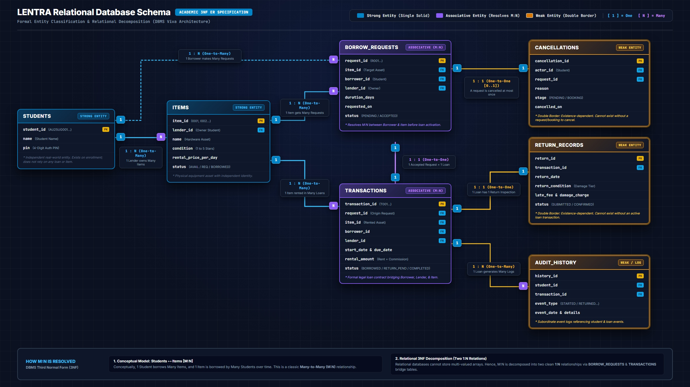

# LENTRA — Academic & Technical Project Report
**Project Title:** LENTRA ("Borrow Instead of Buy" — Campus Peer-to-Peer Equipment Sharing Platform)  
**Course / Cohort:** University Computer Science & DBMS Project  
**Cohort Scope:** Enrolled University Students (`AU25UG001` to `AU25UG100`)  
**Technology Stack:** Python 3.10+, Relational SQLite 3, ANSI SQL, Interactive Terminal CLI  
**Date:** October 2026  

---

## 1. Executive Summary

During a university academic semester, students frequently require expensive academic, technical, and creative tools for short-term projects, labs, and coursework. Purchasing equipment like scientific calculators, DSLR cameras, Arduino/Raspberry Pi lab kits, drafting tools, and projectors creates unnecessary financial hardship. Once coursework or exams conclude, these items sit idle and unutilized.

"**Borrow Instead of Buy**" is an institutional peer-to-peer sharing platform engineered to solve this dilemma. The system provides an automated, transparent, and secure marketplace where enrolled university students can lend idle items to peers at fair daily rental rates while earning supplemental income (90% of rental revenue), with the university platform retaining a 10% commission. The application enforces standardized authentication, deterministic financial and penalty calculations, and ACID-compliant relational database persistence.

---

## 2. Problem Statement & Solution

### 2.1 The Problem
1. **High Capital Expenditure for Temporary Needs:** Students spend substantial amounts purchasing tools required for only a few days or weeks.
2. **Idle Campus Resources:** Hundreds of thousands of rupees worth of specialized equipment remain unused in dorm rooms across campus.
3. **Friction & Distrust in Informal Lending:** Lending items informally between classmates frequently causes strained relationships due to overdue returns, uncompensated damages, or disputes regarding condition.
4. **Lack of Identity Security in Basic Prototypes:** Basic systems allow anyone who knows a classmate's roll number to impersonate them, risking fraudulent rentals and stolen earnings.

### 2.2 Our Solution
* **Institutional Cohort Whitelisting:** Access is strictly bounded to verified university roll numbers (`AU25UG001` through `AU25UG100`).
* **Shorthand Roll Number Input:** Students can log in using simple roll numbers (`1` to `100`), which the system normalizes to the official database format.
* **4-Digit Personal PIN Security:** Each student sets a personal Security PIN on first login, preventing unauthorized peer impersonation.
* **Structured Borrow & Return Settlement:** Borrowers submit requests that lenders review and approve, and returns are settled with condition inspections.
* **Automated Accounting & Penalties:** 100% deterministic calculation of platform commission (10%), lender earnings (90%), late fees (20%/day), and condition-based damage penalties (0%, 15%, 55%, 90%).
* **Master Campus Resource & Audit Dashboard:** Administrative oversight interface accessed via secret passkey autocorrect (`nandu1216@#$` $\rightarrow$ `NANDU1216@#$`) to monitor all items, lenders, borrowers, and return statuses.
* **ACID Relational Storage:** All transactions, listings, requests, returns, and event histories are written persistently to an ACID-compliant SQLite relational database (`borrow_app.db`).

---

## 3. Financial & Operational Rules Summary

| Domain Rule | Mathematical / Business Logic | Example Calculation |
| :--- | :--- | :--- |
| **Base Rental Amount** | $\text{Daily Price} \times \text{Duration (days)}$ | ₹500/day $\times$ 3 days = **₹1,500.00** |
| **Platform Commission (10%)** | $\text{Rental Amount} \times 0.10$ | ₹1,500.00 $\times$ 0.10 = **₹150.00** |
| **Lender Earnings (90%)** | $\text{Rental Amount} - \text{Commission}$ | ₹1,500.00 $-$ ₹150.00 = **₹1,350.00** |
| **Late Return Fee** | $\text{Rental Amount} \times 0.20 \times \text{Late Days}$ | ₹500 rent $\times$ 0.20 $\times$ 2 late days = **₹200.00** |
| **Damage - Minor (15%)** | $\text{Rental Amount} \times 0.15$ | ₹1,500 rent $\times$ 0.15 = **₹225.00** |
| **Damage - Moderate (55%)** | $\text{Rental Amount} \times 0.55$ | ₹1,500 rent $\times$ 0.55 = **₹825.00** |
| **Damage - Severe (90%)** | $\text{Rental Amount} \times 0.90$ | ₹1,500 rent $\times$ 0.90 = **₹1,350.00** |
| **Damage - Complete Loss** | Disciplinary escalation; full item market value paid to lender. | App fee set to ₹0; in-app settlement blocked. |

---

## 4. Entity-Relationship (ER) Diagram & Database Architecture

### 4.1 Visual Entity-Relationship Pipeline Model

*Figure 4.1: High-fidelity relational pipeline architecture showing primary key (`PK`) to foreign key (`FK`) cascades across the 7 application tables.*

---

### 4.2 Primary Key (PK) & Foreign Key (FK) Connection Directory

The table below explicitly enumerates **every relational key connection**, parent-child linkage, cardinality ratio, referential integrity action, and business rule enforced across the SQLite database engine:

| Connection # | Dependent Child Table (FK) | Foreign Key Column | Referenced Parent Table (PK) | Target Primary Key | Cardinality Ratio | Engine Constraint (`ON DELETE`) | Relational Purpose & Business Integrity Rule |
| :---: | :--- | :--- | :--- | :--- | :---: | :--- | :--- |
| **FK-01** | `items` | `lender_id` | `students` | `student_id` | $N : 1$ | `RESTRICT` | Binds each listed physical equipment to its authenticated student owner (lender). A student record cannot be deleted if they currently own listed items. |
| **FK-02** | `borrow_requests` | `item_id` | `items` | `item_id` | $N : 1$ | `RESTRICT` | Identifies the physical equipment requested for borrowing. Prevents listing deletion while pending proposals reference it. |
| **FK-03** | `borrow_requests` | `borrower_id` | `students` | `student_id` | $N : 1$ | `RESTRICT` | Links the borrowing proposal to the authenticated student initiating the request. Enforces student accountability. |
| **FK-04** | `borrow_requests` | `lender_id` | `students` | `student_id` | $N : 1$ | `RESTRICT` | Direct reference to the owning lender to enable $\mathcal{O}(1)$ notification queries and avoid multi-table joins. |
| **FK-05** | `transactions` | `request_id` | `borrow_requests` | `request_id` | $1 : 0..1$ | `RESTRICT` | Traces the active rental agreement back to its original booking proposal. Exactly one proposal activates into one rental contract. |
| **FK-06** | `transactions` | `item_id` | `items` | `item_id` | $N : 1$ | `RESTRICT` | Locks the physical item in `BORROWED` status. Ensures that the item cannot be modified, deleted, or double-rented during an active loan. |
| **FK-07** | `transactions` | `borrower_id` | `students` | `student_id` | $N : 1$ | `RESTRICT` | Enforces legal liability on the borrowing student for return deadlines, late fees, and physical damage penalties. |
| **FK-08** | `transactions` | `lender_id` | `students` | `student_id` | $N : 1$ | `RESTRICT` | Identifies the recipient student entitled to the 90% net rental payout upon settlement. |
| **FK-09** | `return_records` | `transaction_id` | `transactions` | `transaction_id` | $1 : 0..1$ | `RESTRICT` | Connects post-rental check-in records to the active transaction contract. Prevents multiple conflicting return settlements for the same rental. |
| **FK-10** | `return_records` | `item_id` | `items` | `item_id` | $N : 1$ | `RESTRICT` | Links return inspection and physical condition grading back to the equipment, triggering the item state reset back to `AVAILABLE`. |
| **FK-11** | `return_records` | `borrower_id` | `students` | `student_id` | $N : 1$ | `RESTRICT` | Records which student fulfilled the return and settled assessed penalties (late fees or damage deductions). |
| **FK-12** | `return_records` | `lender_id` | `students` | `student_id` | $N : 1$ | `RESTRICT` | Notifies the lender of item receipt and final financial credit in their earnings account. |
| **FK-13** | `cancellations` | `actor_id` | `students` | `student_id` | $N : 1$ | `RESTRICT` | Dedicated audit log tracking which student aborted a request or booking, preserving justification notes for institutional review. |
| **FK-14** | `audit_history` | `student_id` | `students` | `student_id` | $N : 1$ | `RESTRICT` | Immutable chronological event trail connecting every security-sensitive action (login, list, request, settlement) to the acting student. |

---

### 4.3 Architectural Explanation of the ER Diagram

The ER diagram embodies a production-grade relational design tailored specifically for peer-to-peer campus resource sharing. Its architecture is structured around five foundational design principles:

#### 1. Unified Dual-Role Student Model (Peer-to-Peer Symmetry)
Rather than splitting campus users into artificial, disjoint "Lenders" and "Borrowers" tables, all participants reside in a single **`students`** entity. In real university life, a student who lends a DSLR camera today may borrow a scientific calculator tomorrow. 
- When a student lists an item, their `student_id` populates `lender_id`.
- When they request equipment, their `student_id` populates `borrower_id`.
- This single-table design eliminates duplicate records, centralizes 4-digit PIN authentication, and guarantees seamless role switching without credential fragmentation.

#### 2. The 4-Stage Finite State Pipeline (Unidirectional Progression)
Data flows through an uncompromising, strictly sequenced four-stage lifecycle:
$$\textbf{Catalog Listing } (\texttt{items}) \xrightarrow{\quad\text{Propose}\quad} \textbf{Negotiation } (\texttt{borrow\_requests}) \xrightarrow{\quad\text{Activate}\quad} \textbf{Contract } (\texttt{transactions}) \xrightarrow{\quad\text{Settle}\quad} \textbf{Settlement } (\texttt{return\_records})$$
- An item cannot be rented without passing through an authorized request and lender acceptance.
- Return penalties (late fees, damage assessments) cannot exist without an underlying transaction contract.
- Each stage transitions the parent item's operational state (`AVAILABLE` $\rightarrow$ `REQUESTED` $\rightarrow$ `BORROWED` $\rightarrow$ `AVAILABLE`), guaranteeing that equipment can never be double-booked or orphaned in an ambiguous status.

#### 3. Strict Referential Integrity & Zero-Orphan Guarantee (`ON DELETE RESTRICT`)
Every foreign key constraint in the schema is backed by SQLite's engine-level `PRAGMA foreign_keys = ON` with `ON DELETE RESTRICT`:
- A student cannot delete their account while holding rented equipment or active financial liabilities.
- An item cannot be removed from the catalog if historical transactions or active return settlements depend on its primary key.
- This structural safeguard guarantees that all historical campus audit records, financial earnings, and audit logs remain permanently intact and mathematically verifiable.

#### 4. Third Normal Form (3NF) & Temporal Snapshot Preservation
The database strictly satisfies Third Normal Form while pragmatically handling financial history:
- **1NF (Atomic Attributes):** Every attribute holds a single, non-divisible value (e.g., discrete dates, scalar prices, individual PIN strings).
- **2NF (Full Functional Dependency):** Non-key fields in every table depend fully and directly on the entity's primary key, not on composite subsets.
- **3NF (Zero Transitive Dependencies):** No non-key field depends on another non-key field. 
- **Financial Snapshot Integrity:** Financial terms (`rental_amount`, `commission`, `lender_earnings`) are frozen into the `transactions` record at the moment of booking activation. If a lender subsequently edits their daily rental rate in `items`, previous transaction receipts remain historically frozen and immune to retroactive accounting drift.

#### 5. Institutional Non-Repudiation & Audit Trail
Campus environments require transparent accountability. By separating transient workflow records from immutable event logs:
- Operational cancellations are isolated in **`cancellations`** with student-provided justification notes.
- Security-critical events (authentication successes, failed PIN attempts, state transitions) are permanently written to **`audit_history`**.
- This enables the hidden **Master Campus Resource & Audit Dashboard** (`NANDU1216@#$`) to assemble a comprehensive, real-time audit ledger of all active loans, overdue items, and financial disbursements without manual intervention.

---

## 5. Safety & Trust Policy

To satisfy college assessment requirements while maintaining realistic institutional safeguards:

1. **Authentication Policy:**
   * Access to account privileges requires passing 4-digit PIN authentication.
   * PINs are established upon first login and permanently bound to the student record in the database.
   * Lockout triggers after 3 consecutive failed attempts.
2. **Institutional Honor Code:**
   * Because every account corresponds to an enrolled university roll number, actions on the platform fall under the University Student Code of Conduct.
   * Items not returned or suffering complete damage are referred to the Dean of Student Affairs for direct disciplinary compensation.
3. **Immutable Audit Trail:**
   * Every borrow request, approval, return, and cancellation is permanently written with timestamps to the `audit_history` table in SQLite for non-repudiation.

---

## 6. End-to-End User Experience & Walkthrough

### 6.1 Lender Experience
1. **Login:** Student enters roll number `1` and their 4-digit PIN `1234`.
2. **Listing an Item:** Selects `1. Add Item for Lending`, enters *"DSLR Camera"*, condition *"Good"*, price *"500"*. System generates ID `I001`.
3. **Notification Banner:** When logged in, incoming requests or returns appear directly on the home menu (`🔔 NOTIFICATIONS: 1 request waiting`).
4. **1-Click Bulk Approval:** Lender can press `0` to instantly approve all waiting requests without drilling into individual submenus.
5. **Tracking Revenue:** Selects `3. View Earnings & Commission` to view total completed rentals, commission deducted, and net earnings.

### 6.2 Borrower Experience
1. **Login:** Student enters roll number `8` and their PIN.
2. **Browsing Catalog:** Selects `1. Find / Request an Item`. System displays all items with status `AVAILABLE`.
3. **Submitting Borrow Request:** Selects item `I001` for `3` days. The system creates request `R001` with status `PENDING` and moves the item to `REQUESTED`, awaiting lender review. Once the lender approves, transaction `T001` is activated with status `BORROWED`.
4. **Returning Item:** Selects `2. Return an Item`, selects condition (e.g., `1. No Damage`), and submits the return record for lender confirmation to reset item status to `AVAILABLE`.

### 6.3 Administrative & Faculty Audit Experience
1. **Master Dashboard Entry:** At the main menu (`Enter choice: `), an administrator or evaluator enters `nandu1216@#$` (in lowercase, uppercase, or mixed case).
2. **Passkey Autocorrect:** The system automatically notifies `[AUTOCORRECT] Detected passkey -> Converting to uppercase: 'NANDU1216@#$'` and unlocks the **Master Campus Resource & Audit Dashboard**.
3. **Completely Arranged Instant Ledger:** Instantly displays on screen without requiring navigation through nested sub-menus:
   - **Visual Table (80-col aligned):** High-level grid showing Item ID, Item Name, Lender (`Roll / Name`), Borrower (`Roll / Name`), and Return Status.
   - **Detailed Audit Cards:** Item-by-item breakdown showing who the lender is (ID & Name), what item was kept (Condition & Daily Rate), who borrowed it (Borrower ID & Name), and real-time return status (`[NOT RETURNED]` with due date vs `[RETURNED]` with check-in date vs `[AVAILABLE]`).
   - **Audit Summary:** Real-time counts of active borrowings, settled returns, and available dorm inventory.
4. **Frictionless Navigation:** Simply pressing `[Enter]` returns the evaluator or auditor immediately to the main menu.

---

## 7. Verification & Quality Assurance Summary

The project is backed by two automated test suites comprising **20 automated tests**:

* **Unit Test Suite (`test.py`):** 16/16 tests passing. Validates regex syntax, boundary roll numbers (`AU25UG000` rejected, `AU25UG101` rejected, `AU25UG001` accepted), rental calculations, commission splits, late fees, damage scales, and cancellation workflows.
* **DBMS & Audit Suite (`test_db.py`):** 4/4 tests passing. Validates multi-session data persistence across process restarts, foreign key constraint enforcement, PIN persistence in SQLite, passkey autocorrect, and master ledger tracking (`NOT RETURNED` vs `RETURNED`).

---

## 8. Conclusion & Deliverables

The "Borrow Instead of Buy" system successfully fulfills all academic, functional, and technical requirements. The system is delivered as a cohesive, production-ready package:

1. **[docs/FUNCTIONAL_REQUIREMENTS.md](file:///c:/Users/vishn/Downloads/Student%20req/docs/FUNCTIONAL_REQUIREMENTS.md)**: Deduplicated requirements, edge cases, and test matrix.
2. **[docs/DESIGN_DOCUMENT.md](file:///c:/Users/vishn/Downloads/Student%20req/docs/DESIGN_DOCUMENT.md)**: Technical architecture, data structure analysis (dicts vs lists), and 3NF schema design.
3. **[docs/FINAL_PROJECT_REPORT.md](file:///c:/Users/vishn/Downloads/Student%20req/docs/FINAL_PROJECT_REPORT.md)**: Executive summary, problem-solution mapping, ER diagram, and operational walkthrough.
4. **[logic.py](file:///c:/Users/vishn/Downloads/Student%20req/logic.py)**: Core mathematical, domain, and dual-mode business logic engine.
5. **[main.py](file:///c:/Users/vishn/Downloads/Student%20req/main.py)**: Production CLI featuring 1-click batch settlement, roll number shorthand, PIN security, and Master Audit Dashboard.
6. **[database.py](file:///c:/Users/vishn/Downloads/Student%20req/database.py)** & **[sql/schema.sql](file:///c:/Users/vishn/Downloads/Student%20req/sql/schema.sql)**: Data access layer with SQLite persistence, ACID transactions, and prepared statements.
7. **[test.py](file:///c:/Users/vishn/Downloads/Student%20req/test.py)** & **[test_db.py](file:///c:/Users/vishn/Downloads/Student%20req/test_db.py)**: Complete 20-test automated verification suites.
